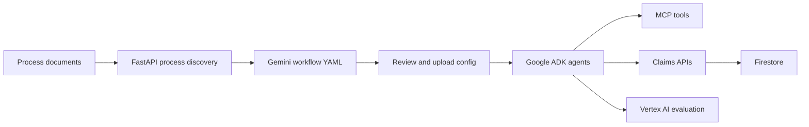

# IntelliForge

**From process documents to tool-connected AI workflows, with claims review in the same backend.**

IntelliForge helps teams turn operating procedures and process files into structured, configurable agent workflows. Its claims APIs connect that workflow layer to patient and claim records, review tasks, reports, and ontology relationships.

Built for the **Google JAPAC Hackathon 2026** with FastAPI, Google ADK, Gemini, MCP, Vertex AI, and Firestore.

## The Demo

1. Upload SOP or other supported process files to `POST /process-files` on the core API. The service extracts the content and returns a workflow configuration proposal.
2. Upload the reviewed YAML to `POST /uploadconfig/{config_id}`. Configurations are stored at `configs/{config_id}/config.yaml`.
3. Run the configured agent workflow with `GET /create_response/?query=...&uuid={config_id}` on the ADK API. Agents can call the MCP tools configured in the YAML.
4. Explore the claims, patient, actionables, final report, and ontology endpoints through the core API's Swagger docs.

Open `/docs` on either running API for interactive requests and schemas. This repository provides the backend APIs; a frontend is not included.

## How It Fits Together



## What It Does

- **Process discovery:** accepts supported files, extracts their content, and uses Gemini to propose a structured agent workflow.
- **Configurable agents:** loads uploaded YAML configurations into Google ADK agents and connects them to MCP or mapped tools.
- **Claims operations:** exposes APIs for claims, patients, locations, devices, review actionables, final reports, and ontology relationships backed by Firestore.
- **Response evaluation:** evaluates agent outputs with Vertex AI metrics for relevance and helpfulness.

## Run Locally

### Requirements

- Python 3.10 or newer
- A Google Cloud project with Firestore enabled for the claims API
- Google Cloud credentials with access to the services you use
- A Gemini API key for process-to-YAML generation

Create an environment and install dependencies from the project root:

```bash
python3 -m venv .venv
source .venv/bin/activate
pip install -r requirements.txt
```

Authenticate with Application Default Credentials, or set `GOOGLE_APPLICATION_CREDENTIALS` to a service-account key file. Create a `.env` file in the project root:

```dotenv
GCP_PROJECT=your-google-cloud-project
GCP_LOCATION=us-central1
GCP_EXPERIMENT=process-evaluation
FIRESTORE_DATABASE=(default)
GOOGLE_API_KEY=your-gemini-api-key
# Optional when using a service-account key instead of ADC:
# GOOGLE_APPLICATION_CREDENTIALS=/absolute/path/to/service-account.json
```

`GCP_PROJECT` and Firestore access are needed by `main.py`. `GOOGLE_API_KEY` is used by process-to-YAML generation. The evaluation endpoint also uses `GCP_LOCATION` and `GCP_EXPERIMENT`. Keep `.env` and credential files out of version control.

### Start The APIs

Start each service in a separate terminal from the project root:

```bash
source .venv/bin/activate
python main.py
```

Core API: <http://localhost:8082> · [Swagger docs](http://localhost:8082/docs)

```bash
source .venv/bin/activate
python main_adk.py
```

ADK agent API: <http://localhost:8081> · [Swagger docs](http://localhost:8081/docs)

Start the MCP server processes needed by your uploaded workflow in additional terminals. For example:

```bash
source .venv/bin/activate
python mcp_servers/AdjudicationSupportEngine.py
```

The available MCP servers are in [`mcp_servers/`](mcp_servers/). Configure each workflow's tool URL to match the server transport and address reachable from the API process.

## API Map

| Service | Useful endpoints | Purpose |
| --- | --- | --- |
| Core API (`8082`) | `POST /process-files` | Extract process documents and generate a workflow proposal |
| Core API (`8082`) | `POST /uploadconfig/{config_id}` | Save a YAML workflow configuration |
| Core API (`8082`) | `/get_all_claims`, `/get_all_patients`, `/get_claim_information/{claim_id}` | Browse claims and patient-related data |
| Core API (`8082`) | `/get_actionables/{claim_id}`, `/update_actionable_decision/{actionable_id}` | Review and update claim actionables |
| Core API (`8082`) | `/store_final_report/`, `/get_final_report/{claim_id}` | Store and retrieve final reports |
| Core API (`8082`) | `POST /evaluate_vertexai` | Evaluate agent responses |
| ADK API (`8081`) | `GET /create_response/` | Execute a configured agent workflow |

See the live Swagger documentation for request bodies, parameters, and the full endpoint list.

## Repository Guide

- [`main.py`](main.py): claims, process discovery, configuration upload, and evaluation APIs
- [`main_adk.py`](main_adk.py): Google ADK workflow execution
- [`sample_config.yaml`](sample_config.yaml): starting template for agent and workflow configuration
- [`mcp_servers/`](mcp_servers/): MCP tool server implementations
- [`prompts/`](prompts/): agent and system prompts
- [`configs/`](configs/): uploaded workflow configurations, created at runtime

## Team

Team IntelliForge